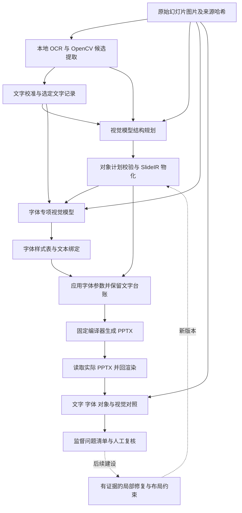

# image2PPT 技术路线与渐进优化方案

更新日期：2026 年 10 月 20 日  
适用范围：当前基于本地视觉分析、外部视觉模型 API、SlideIR 和固定编译器的图片转可编辑 PPT 实验流程。

## 1. 目标与当前判断

项目以原始幻灯片图片为设计依据，重建其中的文字、形状、图标、界面模块及其空间关系，输出可编辑 PPTX。保留原图的内容、比例、层次和布局，不对页面进行通用美化或重新设计。

当前采用渐进优化路线：先固定现有文字内容，打通视觉模型字体参数的识别与复用，再修正模块布局，最后完善模块内部图形与视觉细节。本路线直接建立在现有 API 和编译程序上，不依赖重新执行旧 skill 来完成后续优化。

现阶段的主要判断如下：

- 文字识别和校准已经形成可用链路，当前将已选定文字作为后续排版实验的固定输入；个别待复核记录继续保留，不反复自动改写。
- 当前明显的视觉退化主要来自模块边界、形状、字号层级、相对位置、背景和线条的缺失或失真。继续单独优化 OCR 不能解决这些布局问题。
- 字体应由视觉模型显式提出候选参数，重建程序保存并复用这些参数。本地字形拟合提供对照建议，不能静默替换已选定的模型字体。
- 已能生成实际原生文字和形状，但“对象可编辑”“参数正确写入 PPT”和“外观接近原图”是三个不同的验收维度。
- 当前实验尚未达到忠实还原验收；模块级布局约束和可靠的监督自动修复仍需建设。

## 2. 总体架构

系统分为三个主要部分：本地证据提取、视觉模型规划、确定性重建与验证。模型负责提出结构和样式，程序负责检查、转换、编译与记录；模型输出不直接作为可执行代码。



图中虚线表示尚未完成的可靠自动修复闭环。已有页面可以直接复用现有 SlideIR 和文字台账，从字体专项阶段开始，不必重新执行 OCR 或重做整页结构规划。

目前整体链路由本地 CLI 和实验脚本串联。Python 视觉服务负责分析与部分重建，PPTX 由宿主机固定的 Node.js／Artifact Tool 编译器生成；不能把这些实验脚本的组合描述为已集成完成的 HTTP 一键转换产品。

## 3. 模型与程序分工

| 环节 | 当前技术或实际使用的模型 | 负责内容 | 能力边界 |
|---|---|---|---|
| 文字检测与识别 | RapidOCR、PP-OCRv4、ONNX Runtime | 提取文字、文字框、识别分数和稳定 ID | OCR 框不是最终排版框，识别分数不是人工正确率 |
| 几何候选提取 | OpenCV | 边缘、颜色区域、轮廓、包含与相交关系 | 候选不自动等于 PPT 对象，几何包含不等于语义分组 |
| 文字视觉校准 | 已使用 `qwen/qwen3.5-flash` | 从原图裁剪盲读文字，再对差异进行复核 | 不负责恢复布局、字体或 OCR 漏检内容 |
| 元素结构规划 | 已使用 `kimi/kimi-k2.6` | 判断图形、局部图片、文字归属及位置、颜色、层级 | 参数属于待验证提案，不能保证几何正确 |
| 字体专项规划 | 本次尝试 `qwen/qwen3-vl-plus` | 提出字体族、字号、字重和共享样式 | 代码接入已完成；本次真实调用限流，尚无有效字体结果 |
| 视觉监督 | 已使用 `qwen/qwen3-vl-plus` | 对照原图、实际回渲染和对象清单提出问题 | 已观察到误报，意见尚不自动写回 |
| 参数校验与物化 | Python 确定性程序 | 校验来源、对象、归属和参数，生成 SlideIR | 结构合法不代表视觉正确 |
| PPTX 编译与适配 | 固定 Node.js 编译器、Artifact Tool、OOXML 适配器 | 输出原生对象、字体属性和实际文件 | 不调用模型，不自行决定内容和设计 |

模型名称为用户所用接口中的路由名称，不据此确认底层模型权重身份。上述角色可以采用不同模型；更换模型须保留本次请求配置、原始响应和评价结果，不能把模型切换后的结果混入旧基线。

## 4. 主要处理阶段

### 4.1 输入与证据固定

保存原图、页面尺寸、页序及 SHA-256。后续 OCR、模型计划、字体计划和素材都绑定同一来源，防止不同页面或不同版本的结果误用。

坐标统一使用原图像素坐标，矩形表示为 `[x, y, width, height]`。编译时再转换为目标画布和 PPTX 坐标；不把原图像素、目标像素和字体点数混在同一个参数中。

每次实验生成新目录，保留上一版图片、计划、IR、PPTX 和预览。失败页和失败请求也保留，不能只汇总成功部分。

### 4.2 OCR 与文字校准

本地 OCR 提供初始文本及其位置。文字校准分为两步：第一步仅提供原图裁剪，由视觉模型盲读，不提供 OCR 答案；第二步只针对不一致项，提供原图和两个候选，让模型选择原 OCR、视觉转录、无法确定或非文字。

当前自动采用条件较保守：盲读明确可读、复核选择视觉转录，且变化限于少量汉字。数字、拉丁字符、标点和大幅改写保留待复核状态。两步若使用同一模型，不能当作两个独立真值来源。

该环节输出原始证据、校准证据和逐项记录。当前优化阶段复用已经选定的文字，不因调整字体、布局而再次进行内容改写。

### 4.3 元素结构规划

视觉模型读取原图、文字证据及 OpenCV 候选，提出独立对象：面板底板、标题条、分隔线、箭头、图标、文字、局部复杂图片等。计划记录对象 ID、类型、位置、尺寸、层级、填充和描边，并明确文字归属于哪个原生对象或图片。

简单图形优先生成原生形状，复杂图标、标志和纹理可作为局部图片。图片内部像素不具备原生对象编辑能力，必须与原生文字、形状分别计数。

程序执行来源、范围、唯一 ID 和文字归属检查。原始图片中仍可见的文字不能再覆盖一层相同的原生文字，以免出现残影或重复显示。

当前元素实验禁止整页残差底图，并限制单个栅格对象不超过页面面积的 18%。这是该实验的拆解约束，不是普适的还原质量标准，也不证明拆解结果比图片保留更好。

现有计划虽然可携带模块提示，但当前元素物化仍输出平面对象，尚未形成完整的模块边界、内部对齐和间距约束。对象数量增加后出现布局变散，正是后续需要解决的问题。

### 4.4 三方文字台账

对已有 PPT 的增量修订，比较原始 OCR、校准文字和当前实际 PPTX 文字。先确认实际 PPTX 与对应 IR 一致，再决定是否修改，避免用过期 IR 覆盖用户已经完成的编辑。

已经修正的文字不退回原 OCR；内容冲突时保留当前版本并记录待复核项；图片内部文字不重复生成文本框。混合颜色、粗体等样式在可安全替换的范围内保留。

导出前检查台账和 IR，导出后检查实际 PPTX 的文字与对象清单。台账的作用是保证采用结果可追踪和正确传递，不是重新证明每个字都与原图相同。

### 4.5 视觉字体规划与参数复用

新整体元素计划采用 `ElementPlan/2`，显式要求字体字段。对已有页面，独立 `FontPlan/1` 可以只改变字体，不重新识别文字或修改几何布局。

字体专项采用“样式表＋文字绑定”的方式：模型先提出若干视觉样式，再将每个原生文本 ID 绑定到一个样式。相同外观的文字复用参数；不同字号的标题、正文和界面小字不能仅因同属某个语义类别就被强行统一。

| 字段 | 含义 | 当前处理方式 |
|---|---|---|
| `font_family` | 中文字体族 | 按已验证的本地候选目录解析 |
| `font_latin` | 西文字体族 | 单独写入西文字体属性 |
| `font_size_px` | 原图坐标系的 em 字号 | 按画布比例换算为 PPT 点数 |
| `bold` | 基础粗体状态 | 应用于文本；已有混合字重片段保留 |
| `font_confidence` | 模型自报的判断置信度 | 留档，不解释为经标定的正确概率 |
| `font_evidence` | 字形判断依据 | 留档，供源图和渲染对照 |
| `styles`／`bindings` | 样式定义与文字绑定 | 每个原生文本恰好绑定一次 |

字号转换公式为：

```text
PPT字号（pt）= 原图字号（px）× 目标画布宽度 / 原图宽度 × 72 / 96
```

`Microsoft YaHei`、`雅黑` 等别名规范到当前渲染链可用的“微软雅黑”。缺少字体时明确拒绝，不静默替换，也不自动下载。当前候选目录是项目已验证字体的集合，不代表操作系统全部字体。

模型参数与实际采用值同时保存。对已应用模型字体的文本，本地拟合仅提供建议，不再自动更改该节点的字体、字号、字重、颜色或位置。

当前字体专项覆盖字体族、字号、粗体和共享样式；行距、字距、斜体、缩进尚未纳入这一阶段。截图只能支持字体候选判断，实际字体身份及目标软件中的字体替换仍需另外验证。

### 4.6 确定性重建与导出

通过检查的计划转换为 SlideIR，素材保存为本地文件，authoring 文件绑定 IR 哈希和参数来源。固定编译器依据 IR 生成 PPTX，再完成 OOXML 属性适配、文件检查和实际文件回渲染。

编译器当前支持原生文字、支持范围内的形状、图片、真实分组、原生表格和原生图表。但当前元素拆解实验主要物化 `text`、`shape`、`image`；编译器支持某类对象，不等于视觉模型已经能从真实图片准确识别和生成该类对象。

原生图表使用明确数据并生成对应的嵌入工作簿，不能从没有标注的图片中虚构精确数值。普通线段和箭头形状不等于具有端点附着、自动跟随和重路由能力的语义连接器。

复杂对象集合可使用显式分批导出后合并的路径。该路径解决特定导出停滞问题，只支持其声明的对象类型，不提升视觉识别或布局准确率。

## 5. 数据协议与产物

| 记录或协议 | 用途 | 关键边界 |
|---|---|---|
| `VisionAnalysis`／`CVElementInventory` | 原始文字、位置和几何候选 | 保存证据，不作为设计真值 |
| `OCRCalibration/1` | 文字校准结果 | 保留原文、候选、选择及复核状态 |
| `ElementPlan/1` | 已有元素实验计划 | 可回放；缺少显式字体时沿用旧行为 |
| `ElementPlan/2` | 新元素实验计划 | 要求原生文本明确给出字体参数 |
| `FontPlan/1` | 已有页面的字体专项计划 | 固定文字和布局，仅应用字体样式 |
| `SlideIR 0.1` | 固定编译器输入 | 只接受编译器明确支持的对象和属性 |
| `authoring.json` | IR 作者、来源与字体提案记录 | 使用哈希绑定准确的 IR 修订 |
| `text-ledger.json` | 采用文字与对象对应关系 | 导出前后检查选定内容一致性 |
| `font-application.json` | 字体参数应用记录 | 记录修改前后值，不宣称外观提升 |
| 实际 PPTX、预览和验证报告 | 交付与复核证据 | 验证必须针对最终文件 |

仓库还保留 `ReconstructionPlan` 系列及严格独立 API 评测路径。它们与 `ElementPlan` 是不同协议；`ReconstructionPlan 2.0` 不能直接当作 `ElementPlan/2` 使用。

## 6. 质量验证方法

验证分层进行，分别报告结果，不用一个 PASS 覆盖所有维度。

| 验证层 | 检查内容 | 通过所代表的含义 |
|---|---|---|
| 来源与合同 | 图片哈希、IR 哈希、ID、坐标、文字归属、字体可用性 | 输入和计划可以安全进入本次重建 |
| 实际文件 | PPTX 包完整性、对象清单、文本、字体族、字号、字重 | 指定内容和参数正确进入最终文件 |
| 视觉对照 | 原图与回渲染的整体布局、局部边界、前景差异、文字层级 | 本次调整是否更接近原图，需要按区域判断 |
| 编辑与应用 | 删除、移动、修改后的效果，PowerPoint／WPS 打开与编辑 | 实际编辑行为及目标应用验收情况 |

整体 RGB 平均误差会受到大面积白底影响，因此需要同时观察前景区域和局部模块。像素误差不是相似度百分比，OCR 回读分数也不是人工阅读准确率。关键标题丢失、箭头错误、面板相互覆盖等问题不能被平均指标掩盖。

视觉监督输出应先定位到对象和原图区域，再与实际文件核对。当前监督意见只形成问题清单；后续自动修复必须增加证据核验和修复后回渲染，避免模型误报直接破坏正确内容。

当前工程实验允许多阶段调用、局部修订和有记录的重试。严格独立模型比较则保留每页单次结构规划、零会话修正、零模型修复重试的基线，原始响应不可修改。两个流程的结果不能混合用于模型排名。

## 7. 截至 2026 年 10 月 20 日的实现状态

| 能力 | 当前状态 | 已有证据或限制 |
|---|---|---|
| 本地 OCR 与几何候选 | 已实现 | 已用于 02、03、05 页实验 |
| API 文字校准 | 已完成真实调用 | 275 条文字形成记录；存在机器选择和待复核项 |
| 三方文字台账与导出检查 | 已实现并验证 | 270 个原生文本、5 个图片内记录；导出文字一致性通过 |
| 元素原生拆解 | 已产出真实 PPTX | 三页均存在明显视觉偏差，整体质量未达标 |
| 字体参数合同与复用 | 已实现并完成本地验证 | 原生字体声明、字号、字重和文字可从实际 PPTX 检查 |
| 第 05 页真实字体专项 | 本次未取得有效结果 | 三次 Qwen3-VL-Plus 调用均返回 HTTP 429 限流 |
| 字体专项的新真实效果版 | 尚未生成 | 不能将合成导出验证视为该页效果提升 |
| 模块级布局约束 | 拟建设 | 当前缺少完整的模块边界、内边距、对齐及间距约束 |
| 监督自动修复 | 拟建设 | 监督存在误报，尚未自动写回 |
| PowerPoint／WPS 人工验收 | 未完成 | 当前报告不能替代目标软件验收 |

文字台账接入时，10 处机器校准结果此前已存在于 PPT，实际新增文字修改为 0，三页预览与上一版逐像素一致。因此该版本完成了文字来源记录与导出保护，没有改善布局。

字体专项的工程验证包含 404 项服务测试、36 项协议测试，以及合成样例的实际导出和错误字体拦截。它们证明链路行为，不证明真实截图字体识别准确。真实调用的 HTTP 429 仅能确认本次请求受到服务端限流，不能据此确定是账户配额、模型路由还是其他网关计量因素。

## 8. 渐进优化顺序与阶段交付

### 阶段一：固定内容，建立字体基线

以第 05 页为首个验证样本，保留现有文字台账、坐标和图形。取得有效字体计划后生成只改变字体的新版本，对照原图检查标题、栏目标题、正文和界面小字的层级及文字容纳情况。

交付字体样式表、应用记录、新 PPTX、实际回渲染和逐模块比较。进入下一阶段前，必须确认文字内容未变，字体参数进入实际文件；若出现溢出或明显视觉退化，记录具体文本和原因，不把实验版本直接设为新基线。

### 阶段二：修复模块边界与空间关系

固定已通过对照的字体样式，建立页面模块结构：页眉、说明区、左右面板、文书界面、提示区、流程区和页脚。视觉模型提出模块边界与关系，程序结合原图边缘、位置和比例验证。

拟增加的约束包括模块包含关系、列宽与间隔、内部留白、公共对齐线，以及与原图一致的重叠关系。原图中合理的叠放不能被通用“消除所有重叠”规则破坏。

交付模块结构记录、约束检查、新版 IR 和前后对照。真实 PPT 分组只在成员边界正确、无重复归属且满足层级要求时生成；分组本身不会自动修复错误坐标。

### 阶段三：补齐内部对象与图形样式

按模块恢复窗口底板、纸张区域、正文灰线、分隔线、列表符号、提示连接线、箭头和完整图标边界。先检查对象是否存在、形状是否正确、位置是否合理，再调整填充、描边、渐变和阴影。

每次只修改明确的一类问题并生成新版本，避免字体、布局和图形同时变化而无法判断收益。复杂局部仍可保留图片，但必须记录原因和编辑限制，不能用大图覆盖来掩盖未解决的结构问题。

### 阶段四：形成可验证的局部修复闭环

把监督意见转为对象级修复提案，记录问题区域、对应节点、证据、拟改参数和预期影响。经过程序校验后应用到新 IR，重新导出、回渲染并检查是否改善，同时检查其他区域是否退化。

此阶段需要明确重试预算、失败退出条件和人工接管规则。先让 02、03、05 三页的结果稳定，再扩大到更多页面，不能以批量成功导出替代单页质量收敛。

## 9. 工程入口与结果追踪

| 目录或文件 | 当前职责 |
|---|---|
| `services/vision/src/image2ppt_vision/models.py` | 本地 OCR 和模型资源加载 |
| `services/vision/src/image2ppt_vision/element_inventory.py` | 原图与 OCR 关联的几何候选 |
| `services/vision/src/image2ppt_vision/ocr_calibration.py` | 视觉盲读、差异复核和文字选择 |
| `services/vision/src/image2ppt_vision/supervised_elements.py` | 元素计划校验和 SlideIR 物化 |
| `services/vision/src/image2ppt_vision/text_ledger.py` | 三方文字合并和实际文件检查 |
| `services/vision/src/image2ppt_vision/font_contract.py` | 字体名称、候选目录和参数校验 |
| `services/vision/src/image2ppt_vision/font_plan.py` | 字体请求、字体计划应用和导出检查 |
| `services/vision/src/image2ppt_vision/element_calibration.py` | 本地字体对照与可测量纯色校准 |
| `scripts/font_plan.py` | 字体专项 prepare／apply／verify 入口 |
| `scripts/compose_text_ledger.mjs` | 带文字台账的编译与导出验证 |
| `scripts/compile.mjs`、`scripts/compose.mjs`、`scripts/pptx_xml.py` | 固定编译、组装和 OOXML 适配 |

真实模型调用与离线准备分开。凭据只通过安全输入或进程环境提供，不写入计划和报告。请求、响应可能包含页面内容，保存在本地实验目录；汇总报告只保留必要状态、哈希和统计。网络失败保留记录，不把空响应或失败结果补造成模型计划。

## 10. 相关说明与验证记录

以下文档和产物对应当前实现，作为后续修订的追踪依据：

- [视觉服务与正式入口说明](../services/vision/README.md)
- [独立 API 评测协议](../services/vision/INDEPENDENT_API.md)
- [元素拆解与监督实验](../services/vision/SUPERVISED_ELEMENTS.md)
- [OCR 校准与文字台账](../services/vision/OCR_CALIBRATION.md)
- [字体参数专项接入](../services/vision/FONT_PLANNING.md)
- [当前编译器能力声明](../scripts/capabilities.mjs)
- [02、03、05 页元素拆解结果](../outputs/supervised-elements-20261019/RESULTS.md)
- [文字校准结果](../outputs/ocr-api-calibration-20261019-v3/RESULTS.md)
- [文字台账接入结果](../outputs/text-ledger-integration-20261019/RESULTS.md)
- [字体专项接入与调用记录](../outputs/font-plan-20261020/RESULTS.md)

后续修订应在本文的阶段边界内更新对应实现状态、实际结果和剩余问题，不用测试数量或对象数量替代视觉质量结论。
